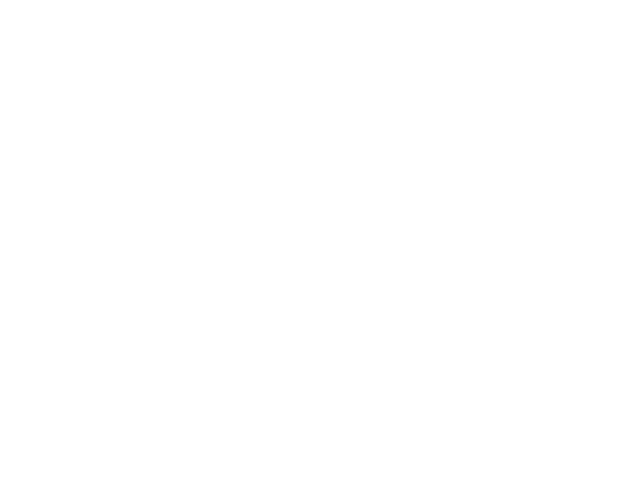

# EDuke32 readable JavaScript checkpoint — November 12, 2026

**Original E1L1 room geometry now renders in Chromium through the original Build engine in readable JavaScript. The full game is still not playable.** Original app_main, CON/game startup, menus, masked walls/sprites, player controls, combat, audio, saves and sustained gameplay remain unverified. There is no verified playable dist/index.html.

This is an actual 640×480 Canvas capture after original allocator/engine/GRP/palette/console/post-initialization, video setup, artLoadFiles, engineLoadBoard, G_InitMultiPsky, videoSetPalette, videoSetViewableArea, renderDrawRoomsQ16 and videoShowFrame. The sky setup uses the original game's four tile globals and original five-descriptor initialization. No world geometry, textures or sky table were fabricated or manually populated. The probe checks 83,928 loaded geometry bytes against the supplied E1L1 MAP, then renders 97 colors and 209,720 nonblack pixels. Source execution traces, module/runtime hashes and PNG SHA-256 are in reports/nov12-original-rooms-frame.json. The screenshot hash is 2d6e3b544cd1a4c8383b5e81fd7c835bd7a53dbab6d19d44d64df9dc3b619a7c. This is an engine-component frame, not app_main/menu/gameplay acceptance.

The earlier original ART/cache probe verifies all 20 ART headers, 10,240 dimensions, a 16 MiB cache and 349,953 exact pixel bytes across 56 representative tiles. Historical campaign evidence loads all 41 maps and checks 4,077,984 geometry bytes. Those historical reports bind their earlier artifact hashes; the latest room-frame report binds the current active component. The canonical original portable LZ4 decoder passes 128 native/Chromium cases including negative-capacity results and canaries. Its original source is unchanged; only that unit selects LZ4_FAST_DEC_LOOP=0.

Shared compiler repairs recover source-defined out-of-line instance methods with exact selected declarations/receiver identity, native nested-array layout contracts, guarded pointer endpoints, proven same-loop terminal cleanup jumps and scalar retention attributes. The new scalar SSE idiom requires the exact native load/convert bodies, float32 parameter and int32 return semantics; it lowers to readable nearest/ties-even arithmetic under default MXCSR. 8,192 native/Node/Chromium results cover float32 ties, signed zero, subnormals, NaNs/infinities and overflow. Assignments now use the exact Clang lvalue type instead of a stale name cache; 2,560 native/full/filtered comparisons verify differently typed shadows, pointer stride/alias writes, float32 and uint16 storage. Unknown closure/vector storage and unsupported source semantics stay blocked.

The latest completed local CI reproduction is 54/54; Node browser/runtime checks are 22/22. The subsequent refresh-driver recipe was validated by the actual successful original renderer execution. These scoped checks do not replace the complete regression suite, full native engine parity, or gameplay acceptance. The driver supports hash-pinned whole-unit fragment refresh while preserving its exact old interface and storage. Its header selection matches normal whole-unit recovery; explicit all-header selection had introduced unrelated dependency conflicts and was refused without altering the owner.

The authoritative classic single-player NOASM profile selects 111 original units. All selected native semantic extraction is current at fingerprint d906809df5e308b38ac6d3351d9a1dac3f959a172419a553ebc2ddb839055730; the codec macro-only refresh reused 110 units and re-extracted one with unchanged neighboring/header semantics. Whole-program current-revision emission/linking and the separate 90% stable-declaration recovery measurement are incomplete. The partial browser graph has 48 source owners and zero invalid imports; remaining ambiguous owners and a storage conflict are not whole-program success. The whole-engine attempt has 19 blocked records, which is not a count of all remaining game blockers.

Next: recover the original renderDrawMasks lambdas and sprite control flow, then original app_main/CON/menu/game-loop startup. The room probe's original game sky initialization fixed an actual missing prerequisite; its earlier null sky pointer was not repaired by inventing storage. Full reachable storage ownership, yielding original simulation, audio, saves, offline bundling and 60-second gameplay evidence are still required. npm run compile:game is not yet a verified playable-release pipeline. Keep Play gated on exact-artifact gameplay evidence.

Preserve the original source/licenses and this canonical codebase. Original Build/game code runs in readable JavaScript. Only approved low-level services may use WASM; no engine/game WASM, CPU emulation, substitute renderer or success stubs. GRPs, SDK/toolchains, raw AST/SQLite databases and asset-bearing generated HTML stay out of GitHub. This screenshot is source-engine evidence, not a playable release.
