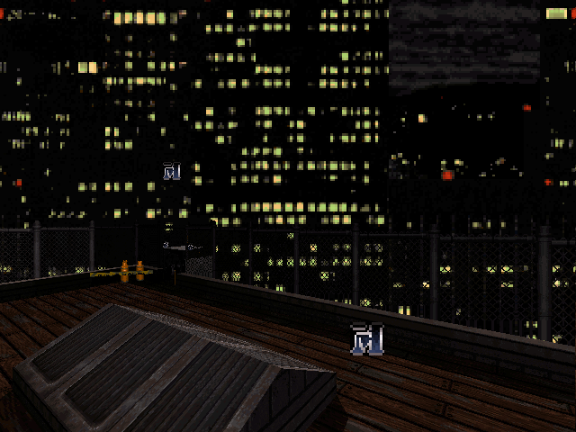

# EDuke32 readable JavaScript port

This project translates original EDuke32 game/Build C/C++ source into readable JavaScript and connects it to browser services. The first target is classic single-player gameplay. Original game/Build code stays JavaScript; approved low-level platform/audio utilities may use WASM.

**Current status: original engine rendering works; original game boot and playable gameplay are not verified. No verified playable dist/index.html exists.**

- Original E1L1 GRP/ART/MAP loading, palettes, room/mask rendering, font initialization and presentation execute in Chromium with zero page exceptions.
- Native comparison covers the original CON arithmetic and division helpers. The new original scalar writer, angle delta and sprite query tests pass in Chromium.
- Original game startup still needs CON and menu closure, including actor array aliases and compatible vector factories. The [VM diagnostic](reports/nov24-vm-provider-frontier.json) lists the unresolved names and rejected imports for its recorded build.

[Current status and evidence](CURRENT_PORT_STATUS.md) · [Continuation commands](CONTINUE_HERE.md) · [Release tracker](https://github.com/NullNRG/eduke32-readable-js/issues/2)



[Renderer evidence](reports/nov24-original-text-startup-frame.json) records the module hashes and browser trace. Run `npm run serve:project` and open the engine preview to load a local GRP and MAP.

## Build and development

Install dependencies and configure Clang using [BUILD_PORTABILITY.md](BUILD_PORTABILITY.md).
Then use:

```sh
npm ci
npm run serve:project
npm run verify:engine-startup
npm run recover:app-main
npm run compile:game
npm run test:recovery
```

The strict game build currently fails incomplete-game acceptance. The active
browser profile selects 111 original Make units and excludes desktop dialogs,
GTK, enhanced renderers, multiplayer, mimalloc, optional external codecs and ALSA.
GNU Make is required for source selection. Compilation and recovery share this
configuration and select the original GenericAllocator backend. Read
[BROWSER_SERVICES.md](BROWSER_SERVICES.md) for the pinned native-services SDK.
Original engine pre-initialization passes; original game startup and playable output
remain unfinished. Open `launch-project.cmd` on the configured Windows host or
visit http://127.0.0.1:8765/ after starting the service. The root launcher provides
an interactive original engine diagnostic, targeted app_main recovery, build,
test, acceptance, cleanup and private continuation packaging actions. Its Play
control requires gameplay evidence matching the exact built HTML. The launcher
is a local development interface; it is not a hosted playable game.

## Assets and publication

Game data is not included in this public repository. Supply your own `DUKE3D.GRP`
locally. Do not commit GRP archives or generated HTML containing embedded game data.
The public player will load a local GRP; local offline builds may embed it.

The original source archives and license notices are preserved. Downloaded
compilers, raw AST caches, old builds and large generated databases are excluded.
`python tools/project_workspace.py package --public` creates a source-only archive;
the existing private continuation package can include local game data.

GitHub Actions currently runs basic source/runtime checks. Deployment is disabled
until original startup, menu, level rendering and controlled gameplay pass.

Original dynamic-name initialization also executes in Node and Chromium, with 2,311 native comparison rows. Use `npm run serve:project -- --port 8766` to select an alternate launcher port. Full game startup and gameplay remain incomplete.
